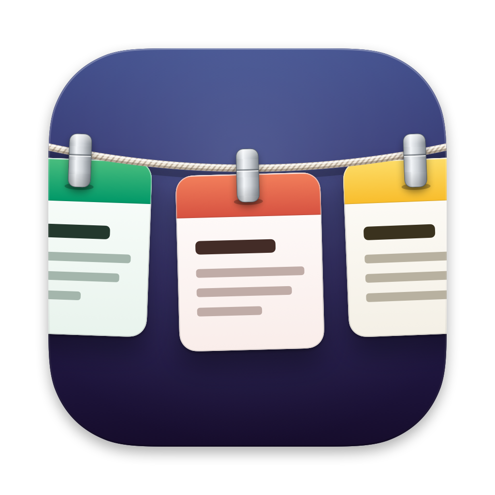
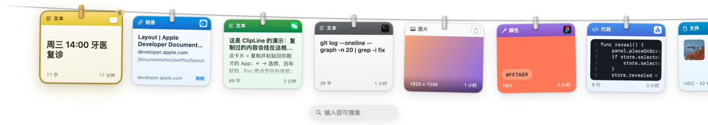
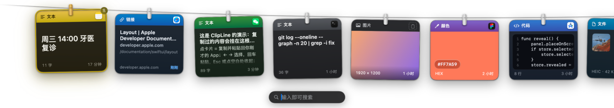
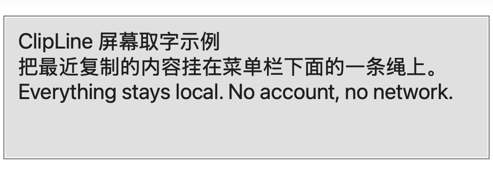
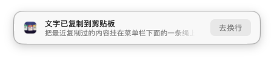

<p align="center">
  
</p>

<h1 align="center">ClipLine</h1>

<p align="center">
把剪贴板挂在晾衣绳上的 macOS 剪贴板管理器。<br>
每次复制都会变成一张卡片，用衣夹挂到菜单栏下方的一根绳上——卡片色头染着来源 App 的颜色。
</p>

<p align="center">
  <a href="README.md">English</a>
</p>



## 特性

- **晾衣绳**：按 `⌃⌥V`，一条绳从菜单栏下方垂下来，最近的复制内容挂成一排卡片。点一张卡片就粘贴回你刚才的 App，面板全程不抢焦点。
- **染色吊牌**：每张卡片顶部的色头取自来源 App 图标的颜色，并显示该 App 图标——一眼看清内容从哪来。链接、代码、颜色、图片、文件各有自己的卡片样式。
- **打字即搜索**：展开后直接打字。大小写、全半角不敏感；空格分词（要求全部命中）；覆盖正文、文件名、来源 App 名，以及**图片里的文字**（本机 OCR，简体中文 + 英文）。
- **隐私优先**：历史存在本机 SQLite 数据库。无账号、无网络、无统计。密码管理器标记为隐藏/临时的内容从不记录、从不落盘。
- **置顶、拖拽、开机自启**：置顶卡片永久保留（黄铜衣夹，不被容量淘汰、清空历史时保留）；卡片可拖进任意 App，内容也能拖上绳；可选登录时自动启动。
- **标签板**：`⇧⌘N`（或底部面板顶栏的 ＋）新建标签，右键卡片「固定到 ▸ 标签」归类。归入标签的条目退出剪贴板历史流转（不被容量淘汰、清空历史时保留），同内容重新复制时归属跟着走；标签右键可重命名 / 换色（8 色）/ 删除。晾衣绳搜索框旁的「全部 ⌄」切换可只看某个标签。
- **底部卡片面板（Paste 式，二选一）**：设置里可把面板换成贴屏幕底边的液态玻璃浮层（macOS 26+ 用官方玻璃材质，旧系统自动回退），下面挂一排近正方形大卡（来源色头部 + 内容预览、尺寸/文件名徽标）；顶栏带搜索、剪贴板历史与标签页。点卡同样是直接粘贴、不抢焦点。
- **屏幕取字（屏幕 OCR）**：按 `⌃⌥O`——所有屏幕先定格成一张静态画面，再盖上不压暗的框选遮罩；光标变准星并实时显示坐标，框选屏幕上任意文字（按住空格可整体挪动选区）。松手即在本机识别，文字进剪贴板与剪贴板绳，屏幕顶部弹一张确认小卡（带内容预览与「去换行」一键去换行）。
- **设置面板**：菜单栏图标右键 → 设置。两个快捷键都可改，OCR 主语言可选，「去换行」/ 粘贴方式 / 历史容量都能调。

| | |
|---|---|
|  |  |
|  | |

## 安装

到 [最新 Release](https://github.com/lixiaoshuang79/ClipLine/releases/latest) 下载 `ClipLine-<版本>.dmg`，打开后把 ClipLine 拖进 Applications。

App 使用本地证书签名（未经公证），**首次打开会被 macOS 拦下**（提示「未打开"ClipLine"」）。放行方法：**打开 系统设置 → 隐私与安全性 → 在下方「安全性」一栏点「仍要打开」**；macOS 14 及更早的系统可以直接右键 App →「打开」。

每个版本都用同一张固定证书签名——授予过一次的权限（屏幕取字要的「屏幕录制」、自动粘贴要的「辅助功能」）会跨版本保留，升级后不用重新授权。

之后按 `⌃⌥V` 唤出剪贴板绳，首次点卡片时按提示授予辅助功能权限。

也可以从源码构建——见下。

## 系统要求

- macOS 14 Sonoma 或更高（Apple 芯片 / Intel 均可）。
- 构建需要 Xcode（推荐）或 Swift 工具链。零第三方依赖。

## 构建与运行

```sh
git clone https://github.com/lixiaoshuang79/ClipLine.git
cd ClipLine
scripts/build-app.sh          # 产出 build/ClipLine.app
open build/ClipLine.app
```

本地构建的 App 是 ad-hoc 签名（构建脚本在钥匙串里发现 "ClipLine Dev" 签名身份时会优先使用）。想自动粘贴，第一次点卡片时按提示授予辅助功能权限（系统设置 → 隐私与安全性 → 辅助功能）；不授权时点卡片只复制到剪贴板。`scripts/make-dmg.sh` 可以打出可分发 DMG。

## 使用

| 操作 | 方式 |
|---|---|
| 唤出 / 收起 | `⌃⌥V`，或点菜单栏图标 |
| 粘贴卡片 | 点卡片，或 `←` `→` 选择后回车 |
| 搜索 | 直接打字；空格分词（全部命中）；`Esc` 先清词、再按一次收起 |
| 置顶 / 取消 | 悬停卡片 → 右上角图钉；置顶卡换黄铜衣夹并排到最前 |
| 摘除 | 悬停卡片 → 左上角 `×` |
| 拖出去 | 把卡片拖进编辑器、聊天窗或访达；绳上这条保留 |
| 拖进来 | 把文本 / 图片 / 文件拖到面板上，松手即挂上绳 |
| 屏幕取字 | `⌃⌥O` → 拖框选住文字（空格挪选区；`Esc` / 右键取消） |
| 设置 | 菜单栏图标（右键）→ 设置 |
| 登录时启动 | 菜单栏图标（右键）→ 登录时启动 |
| 清空历史 | 菜单栏图标（右键）→ 清空历史（置顶卡片保留） |

## 数据与隐私

- 历史：`~/Library/Application Support/ClipLine/history.sqlite`（目录 0700、文件 0600）。上限 500 条 + 图片总预算 256MB，超出先淘汰最旧。
- OCR 全部在本机用 Vision 框架完成，任何数据都不出这台电脑。
- 被标记为隐藏 / 临时 / 自动生成的内容（`org.nspasteboard` 约定）在读取任何数据之前就被丢弃，存储层还会再拒一次。

## 已知限制

- 多选文件拖出去只会送达其中一条（`NSItemProvider` 的限制）；单个文件与文件夹正常。
- 图片复制后 1–2 秒 OCR 文字才能被搜到。

## 致谢与许可

晾衣绳面板、衣夹与整体视觉语言改编自 [Tendedero](https://github.com/alejandrobujan/tendedero)（MIT）；剪贴板采集与粘贴机制参考 [Maccy](https://github.com/p0deje/Maccy)（MIT）。完整第三方声明见 [ATTRIBUTION.md](ATTRIBUTION.md) 与 [NOTICE](NOTICE)。

ClipLine 使用 [Apache License 2.0](LICENSE) 许可。
